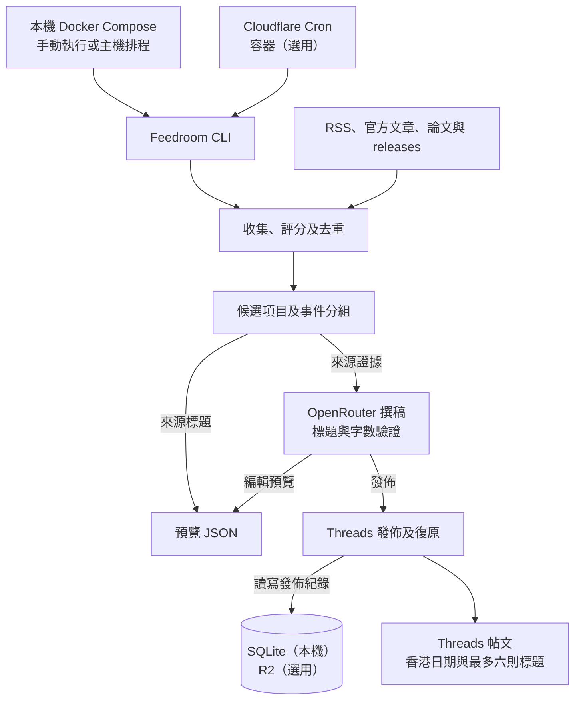

# Feedroom

Feedroom 每天為指定 Threads 帳戶整理一篇 AI 與資料科學摘要。第一行是香港日期（`YYYY-MM-DD`），接着用香港粵語逐行列出五至六則短標題，每篇最多六項。來源證據不足或受 500 字元上限所限時，可以少於五項。 [Threads 發佈規格](https://developers.facebook.com/documentation/threads/posts)

```text
2026-11-19
• 標題一
• 標題二
• 標題三
• 標題四
• 標題五
```

帖文加上 `AI Threads` 主題標籤。預覽 JSON 的 `draft.source_urls` 和發佈紀錄會依標題順序保存每項對應的原文網址。 [AI Threads 主題](https://www.threads.com/search/?q=aithreads&serp_type=tags&hl=zh-hk) · [Threads 主題標籤](https://developers.facebook.com/documentation/threads/posts#topic-tags)

## 架構



## 本機 Docker

在運行每日摘要的電腦安裝 Docker 和 Compose v2。在 repo 根目錄建立本機 `.env`、建置映像，並先看一次來源預覽。Git 會忽略 `.env`。 [.env.example](.env.example)

```sh
cp -n .env.example .env
docker compose build feedroom
docker compose run --rm feedroom preview
```

`preview` 預設直接採用來源標題，可在未設定憑證時執行。要預覽正式的粵語摘要，在 `.env` 填入 `OPENROUTER_API_KEY` 和支援結構化輸出的 `OPENROUTER_MODEL`，再執行編輯預覽。兩種預覽都以收集日期作為香港日期，並將可用草稿輸出為 JSON。 [OpenRouter 結構化輸出](https://openrouter.ai/docs/guides/features/structured-outputs)

```sh
docker compose run --rm feedroom preview --editorial
```

### 圖卡預覽

`preview --cards-dir` 依帖文清單的順序為每則消息輸出一張 1080 × 1350 px PNG。每張卡頂部標示「每日 AI 摘要」。JSON 的 `draft.text` 是香港日期及標題清單，`draft.cards` 包含相同標題、摘要、來源與原文網址，`card_images` 對應由 `01.png` 開始的圖檔。輸出目錄須是新目錄，重跑可另選目錄。

在 Python 環境安裝 `.[cards]` 及 Chromium 後，可用測試資料重播。範例 JSON 收錄五則虛構消息，預覽毋須憑證。

```sh
python -m pip install '.[cards]'
python -m playwright install --only-shell chromium
feedroom preview --candidates tests/fixtures/card_candidates.json --cards-dir build/cards-fixture
```

來源模式摘錄來源摘要的首一至兩句完整句子。加上 `--editorial` 可用 OpenRouter 撰寫有來源支持的粵語標題及一至兩句圖卡摘要。每則編輯標題保留開頭的主要消息，最多 40 字元，補充細節放在圖卡摘要。可用細節不足時會省略摘要，並為已選的標題保留一張卡。

Docker 的 `cards` target 隨附 Chromium 和 Noto CJK 字型。以下使用同一份五則消息的 fixture，並將圖檔寫入本機 `build/`。 [Playwright Docker 文件](https://playwright.dev/python/docs/docker)

```sh
mkdir -p build
docker build --target cards -t feedroom-cards:preview .
docker run --rm --init --ipc=host --network none \
  --mount "type=bind,source=$PWD/tests/fixtures/card_candidates.json,target=/fixtures/cards.json,readonly" \
  --mount "type=bind,source=$PWD/build,target=/output" \
  feedroom-cards:preview preview --candidates /fixtures/cards.json --cards-dir /output/cards-docker
```

### 每週 AI 摘要預覽

`weekly-preview` 以香港時間週一 00:00 至指定截稿時間試排選題。SQLite 紀錄中，實際在期內發佈的日更可以納入，原文早於本週亦可。週報最多三則，其中最多一則可從本週發佈的原文補選。只有日期的來源按香港日曆日比較。缺少 Threads 發佈時間的舊紀錄視為時間未確認。Hacker News 提交時間及 TLDR、DAIR.AI 的週刊日期均無法確認原文日期。

每則故事用一至兩張淡灰綠圖卡。同一故事的圖卡共用主標題和字級，第二張直接補上機制、評測條件或限制。標題和圖卡內容以每則所連結的原文為依據。帖文包含涵蓋日期與原文網址，並在 500 字元內按重要性保留可容納的故事。

設定 `OPENROUTER_API_KEY`、`OPENROUTER_MODEL` 及 `THREADS_ACCOUNT_ID` 後，可用下列指令生成草稿。`--daily-journal` 可指定現有 SQLite 紀錄，CLI 以唯讀模式開啟。加上 `--candidates` 可重播既有的 `feedroom collect` JSON。需要圖卡時提供新的 `--cards-dir`。

```sh
feedroom weekly-preview --as-of 2026-11-22T18:00:00+08:00 \
  --daily-journal state/threads.sqlite3 --cards-dir build/weekly-2026-11-22
```

### 用 R2 發佈圖卡

本機可以用 `publish --with-cards` 發佈當日摘要。Feedroom 會按香港日期把 PNG 放到專用的私人 R2 bucket，路徑為 `threads/YYYY-MM-DD/`。一張圖卡會發成單圖，多張會按摘要順序發成輪播。Meta 透過有效一小時的簽名網址讀取圖卡。 [Threads 輪播文件](https://developers.facebook.com/documentation/threads/posts#carousel-posts) · [R2 簽名網址](https://developers.cloudflare.com/r2/api/s3/presigned-urls/)

建立私人 bucket `feedroom-media` 和一組只限該 bucket 的 **Object Read & Write** S3 憑證。將以下變數填入本機 `.env`。請保留 bucket 的私人設定。 [R2 憑證設定](https://developers.cloudflare.com/r2/api/tokens/)

```dotenv
FEEDROOM_MEDIA_R2_ACCOUNT_ID=
FEEDROOM_MEDIA_R2_BUCKET=feedroom-media
FEEDROOM_MEDIA_R2_ACCESS_KEY_ID=
FEEDROOM_MEDIA_R2_SECRET_ACCESS_KEY=
```

```sh
docker compose --profile cards build feedroom-cards
docker compose --profile cards run --rm feedroom-cards publish --with-cards
```

兩種日更發佈方式共用同一時段的紀錄。同一香港日期已發佈日更時，指令回傳 `already_published`。Mac 的日更排程使用 `feedroom-cards publish --with-cards`，純文字發佈則用 `feedroom publish`。圖卡指令可以重用已確認的圖片容器，繼續未完成的輪播。若 Threads 將已保存的貼文容器標為 `ERROR` 或 `EXPIRED`，須先核對當日發佈紀錄。

### Threads 帳戶與試帖

在 Meta 建立 Threads App，用已加入的 tester 帳戶作首次驗證。將該帳戶的數字使用者 ID 填入 `THREADS_ACCOUNT_ID`，並將同一帳戶的長效 Threads User Access Token 填入 `THREADS_ACCESS_TOKEN`。Token 需具備 `threads_basic` 和 `threads_content_publish`。由操作者在到期前用 Meta 的 `refresh_access_token` 更新憑證。 [Meta 開始使用](https://developers.facebook.com/documentation/threads/get-started) · [發佈權限](https://developers.facebook.com/documentation/threads/posts#permissions)

確認編輯預覽和目標帳戶後，執行以下指令發佈試帖。成功時 CLI 會回傳 `published` 和 `post_id`。

```sh
docker compose run --rm feedroom publish
```

發佈會先核對 token 帳戶，並以執行當日的香港日期撰稿。草稿通過驗證後，程式建立附有主題標籤的純文字 Threads container，省略連結附件與 AI 自我揭露欄位，待它就緒才發佈。Meta 仍可自行加上 AI 標籤。同一時段已有帖文會回傳 `already_published`，無合適消息則跳過。若發佈回應中斷，重跑會先查原 container 和帳戶帖文。狀態仍不明時會暫停新發佈。 [Meta 發佈流程](https://developers.facebook.com/documentation/threads/posts) · [Meta 發佈狀態](https://developers.facebook.com/documentation/threads/troubleshooting)

### 下午「今日讀一篇」

日更收集後會把 `reading` 清單保存在 Compose 的 `threads-state` volume。下午優先用同一帳戶、同一香港日期的清單，按原有排序找一篇能讀到 arXiv 原文摘要的論文。清單缺失、過期或沒有合適論文時，會重新收集 Hugging Face Daily Papers 和 DAIR.AI。可從任一來源選題，但原文連結必須指向 arXiv 論文頁。發佈時按帳戶歷史排除已刊出的論文，沒有合資格論文便跳過。

先用 Docker 預覽並核對選題、粵語摘要、原文連結和字數。預覽需要 OpenRouter 設定。若已配置 `THREADS_ACCOUNT_ID`，預覽會嘗試讀取該帳戶的候選快照，並唯讀核對已配置的 SQLite 或 R2 發佈紀錄。輸出的 `candidate_source` 會標示用快照 `cached` 或重新收集 `fresh`。

```sh
docker compose --env-file .env build feedroom
docker compose --env-file .env run --rm feedroom paper-preview
```

確認預覽後，用下文同一主機、Docker context、Compose project 和 `.env` 排程執行 `feedroom paper-publish`，讓日更和下午任務共用快照及發佈紀錄。

### 每日排程與發佈紀錄

試帖確認後，由本機主機排程每日呼叫 Compose，並保留輸出及錯誤紀錄。排程時主機需開機，Docker 服務需已啟動。以下是 UTC 主機的 cron 範例，日更為香港時間 08:00，論文為香港時間 15:00。下午鐘點可在主機排程中調整，啟用前先核對並避開日更和週日欄目。使用其他主機時區請換算時間，並換入實際 checkout 和 Docker 路徑。

```cron
0 0 * * * cd "/absolute/path/to/feedroom" && "/absolute/path/to/docker" compose --env-file .env run --rm feedroom publish
0 7 * * * cd "/absolute/path/to/feedroom" && "/absolute/path/to/docker" compose --env-file .env run --rm feedroom paper-publish
```

Compose 用 `threads-state` volume 保存 `/data/threads.sqlite3` 及每個帳戶的 `/data/reading-<帳戶 ID>.json`。每個帳戶在同一香港日期及時段最多發佈一次。搬遷主機前先備份 volume，切換排程前先處理未確認的發佈，並確認新環境讀到同一份歷史。每個帳戶的每個時段只啟用一個觸發器。

### 發版

1. 版本由 `v00001` 起順序遞增。每版從最新 `main` 建立短期的 `release/vXXXXX` 分支，例如 `release/v00001`。本版功能和修正的 PR 以該分支為 base，改動記在 [CHANGELOG.md](CHANGELOG.md) 的 `Unreleased`。
2. 整批驗收後，把本版的條目移到 `## [v00001] - YYYY-MM-DD` 這類同版本區段，填上實際發版日期。從 release 分支開定版 PR 至 `main`，通過 PR 檢查後合併。
3. 到 GitHub 核對同名 release PR 的合併 SHA，並確認 [Feedroom checks](.github/workflows/feedroom-checks.yml) 在 `main` 上對該 SHA 的 push 執行成功。把同版本的 Git tag 指向該 SHA，並使用該版 changelog 發佈同名 GitHub Release。重試前核對既有 tag 的 SHA 及 Release 的版本和內容。
4. 發佈後，按下方流程用該 Git tag 建置及驗證同版本的 Docker 映像。

### 本機 Docker 映像政策

Mac LaunchAgent `local.feedroom.publish` 在香港時間 09:30 用 `desktop-linux`、Compose project `feedroom` 和 `.env` 執行 `feedroom-cards publish --with-cards`。更新前先用 `launchctl print "gui/$(id -u)/local.feedroom.publish"` 確認實際服務，並在發佈工作結束後切換標籤。若另有時段排程使用 `feedroom` 服務，按同一流程更新 `feedroom-feedroom` 的 `runtime` target，並用 `--help` 驗證該服務。

排程主機在 `.env` 設定 `FEEDROOM_CARDS_IMAGE=feedroom-cards:latest`。開發 checkout 則由 Compose project 決定圖卡映像名稱。由舊版遷移時，先將原有 `feedroom-feedroom-cards:latest` 加上 `feedroom-cards:latest` 標籤，再設定 `.env` 和同步排程 checkout。Compose 改用新名稱後會沿用原有映像，直至正式版本通過驗證。

1. 從同步到 `origin/main` 的乾淨排程 checkout 操作。用 `df -h /System/Volumes/Data` 和 `docker --context desktop-linux system df` 檢查 Mac 可用空間、映像及建置快取。有足夠主機空間才建置。若排程日誌顯示 Docker 無法啟動，先檢查 Docker Desktop 的主機日誌和磁碟，再查 Threads。
2. 選定已發佈的 GitHub Release，並核對 Git tag 指向定版 PR 的合併 SHA。用獨立 worktree 從該 tag 建置，例如 `feedroom-cards:v00001`。OCI labels 記錄版本及完整 Git SHA。相同版本的映像可在兩項 label 都相符時重用。先為目前使用的映像加上帶 UTC 時間的回退標籤。首次安裝尚無現用映像時，略過回退標籤。

   ```sh
   version=v00001
   git fetch origin tag "$version"
   revision=$(git rev-parse "refs/tags/$version^{commit}")
   release_checkout=$(mktemp -d "${TMPDIR:-/tmp}/feedroom-release.XXXXXX")
   git worktree add --detach "$release_checkout" "$revision"
   repository=feedroom-cards
   active="${repository}:latest"
   if previous_id=$(docker --context desktop-linux image inspect --format '{{.Id}}' "$active" 2>/dev/null); then
     rollback="${repository}:before-refresh-$(date -u +%Y%m%dT%H%M%SZ)"
     docker --context desktop-linux image tag "$previous_id" "$rollback"
   fi
   candidate="${repository}:$version"
   if ! docker --context desktop-linux image inspect "$candidate" >/dev/null 2>&1; then
     docker --context desktop-linux build --target cards \
       --label "org.opencontainers.image.version=$version" \
       --label "org.opencontainers.image.revision=$revision" --tag "$candidate" "$release_checkout"
   fi
   docker --context desktop-linux image inspect \
     --format '{{.Id}} {{index .Config.Labels "org.opencontainers.image.version"}} {{index .Config.Labels "org.opencontainers.image.revision"}}' "$candidate"
   ```

3. 確認 OCI labels 分別符合 `$version` 和 `$revision`。先用發佈版本的 fixture 渲染並核對 `card_images` 有五張圖卡。驗證通過後，才更新排程使用的 `latest` 並執行 Compose 啟動檢查。將版本、Git SHA、前後 image ID、回退標籤和驗證結果記錄在 Git 忽略的 `build/docker-images/`。

   ```sh
   docker --context desktop-linux run --rm --pull never --network none \
     --mount "type=bind,src=$release_checkout/tests/fixtures/card_candidates.json,dst=/tmp/card-candidates.json,readonly" \
     "$candidate" preview --candidates /tmp/card-candidates.json --cards-dir /tmp/card-check
   ```

   ```sh
   docker --context desktop-linux image tag "$candidate" "$active"
   docker --context desktop-linux compose -p feedroom --env-file .env --profile cards \
     run --rm --no-deps --pull never -T --interactive=false feedroom-cards --help
   ```

   若 Compose 啟動檢查失敗且有回退映像，把記錄中的回退標籤重新標為 `feedroom-cards:latest`，再執行同一個檢查。沿用 `feedroom_threads-state`，其中的發佈歷史可防止重複發帖。完成操作後用 `git worktree remove "$release_checkout"` 移除暫存 checkout。

4. 每次更新後檢查保留狀況。每個有排程的服務保留現用映像及最近兩個不同的已驗證回退映像。清理前核對所有已載入的排程、容器使用的映像和回退紀錄，逐個確認舊標籤後用 `docker --context desktop-linux image rm --no-prune` 移除指定標籤。建置快取獨立檢查，按需另外清理。保留所有專案的 volumes，清理範圍限於已確認的 Feedroom 映像。

## 來源與選題

`feedroom collect` 收集、正規化、評分和去重，並輸出 JSON。`latest` 收錄最近 36 小時的新聞、文章和 releases。`reading` 預設回看 90 日，收錄 Hugging Face Daily Papers 上至少有 100 個 upvote 的論文，並檢查 DAIR.AI 最近一期涵蓋期已完結的週刊。兩個來源的論文以 arXiv 連結去重，最多共八篇候選。清單會為合資格的 DAIR.AI 論文預留一個位置。 [Hugging Face Daily Papers API](https://huggingface.co/docs/huggingface_hub/main/en/package_reference/hf_api#huggingface_hub.HfApi.list_daily_papers) · [DAIR.AI Papers](https://academy.dair.ai/papers)

撰稿前會合併同一事件的報道，並嘗試補讀已配置來源的文章正文。補讀遵守 `robots.txt`，遇到封鎖或正文太短時沿用來源摘要。OpenRouter 根據每組事件的證據撰寫短標題，程式核對事件 ID、數字、格式和字數。收集失敗的來源會記錄在 `collection_errors`，其餘來源繼續收集。

### 主要研究與工程來源

- OpenAI 官方綜合 feed 提供 Research 和 Signals 文章。 [OpenAI RSS](https://openai.com/news/rss.xml)
- Anthropic 文章從官方頁面讀取摘要和日期。 [Anthropic News](https://www.anthropic.com/news) · [Anthropic Research](https://www.anthropic.com/research)
- Google 和 Google DeepMind 的官方 blog 提供模型、研究、科學和應用文章。 [DeepMind Blog](https://deepmind.google/blog/rss.xml) · [Google Research](https://research.google/blog/rss/) · [Google Innovation & AI](https://blog.google/innovation-and-ai/rss/)
- Apple、Meta 和 Microsoft 補充機器學習研究與工程實務。 [Apple Machine Learning Research](https://machinelearning.apple.com/) · [Meta Engineering AI Research](https://engineering.fb.com/category/ai-research/feed/) · [Microsoft Research](https://www.microsoft.com/en-us/research/feed/)
- Netflix、Spotify 和 Uber 補充推薦系統、資料平台和 AI 工程。Uber 讀取官方工程頁當頁最多 20 篇。 [Netflix TechBlog](https://netflixtechblog.com/feed) · [Spotify Engineering](https://engineering.atspotify.com/feed/) · [Uber Engineering](https://www.uber.com/us/en/blog/engineering/)

另有 Hugging Face RSS、AWS Machine Learning Blog、Databricks、PyTorch、NVIDIA Blog、TLDR AI、MIT Technology Review AI、The Verge AI、TechCrunch AI、Hacker News Algolia 與指定 GitHub releases。TLDR AI 會展開至原文連結。企業工程文章須符合 AI、資料科學、資料工程、推薦系統或實驗等主題。覆蓋範圍取決於各來源提供的內容。

## Python 開發與重播

套件支援 Python 3.11 或以上。本機 Python CLI 讀取目前程序的環境變數。要用已收集的候選重現預覽，可先保存 `collect` 的 JSON，再傳給 `preview --candidates`。為收集或即時預覽指定 `--as-of` 可調整參考時間，歷史涵蓋範圍取決於來源網站。

```sh
python3 -m venv .venv
. .venv/bin/activate
python -m pip install '.[r2]'
feedroom collect > /tmp/feedroom-candidates.json
feedroom preview --candidates /tmp/feedroom-candidates.json
python -m unittest discover -s tests -v
node --test tests/cloudflare.test.mjs
```

原有 `python3 scripts/ai_news_collect.py` 仍可用於手動收集。其 `--mark-seen` 管理獨立的 14 日已讀紀錄。

## Cloudflare（選用）

`cloudflare.config.ts` 透過 Cloudflare Containers 和 Cron Triggers 在每日 08:00 HKT 執行同一映像。部署需 Cloudflare Workers Paid、Docker 和 Node.js 24.22 或同系列更新版本。用 `npm ci` 安裝指定的 CLI，再執行 `npx cf build` 檢查建置。`npx cf deploy` 的排程預設執行 `preview`。 [Cloudflare CLI](https://developers.cloudflare.com/cf/projects/) · [Cloudflare 排程容器](https://developers.cloudflare.com/containers/examples/cron/)

要在 Cloudflare 發佈，準備私人 R2 bucket，以及只限該 bucket 的 Object Read & Write 憑證。在 Worker Settings → Variables and Secrets 設定兩項 OpenRouter 變數、兩項 Threads 變數及 `FEEDROOM_R2_ACCOUNT_ID`、`FEEDROOM_R2_BUCKET`、`FEEDROOM_R2_ACCESS_KEY_ID`、`FEEDROOM_R2_SECRET_ACCESS_KEY`，再執行 `npx cf deploy --mode publish`。發佈歷史會保存於 `threads/<Threads account ID>.json`，跨容器休眠保留。 [Worker secrets](https://developers.cloudflare.com/workers/configuration/secrets/) · [R2 憑證](https://developers.cloudflare.com/r2/api/tokens/) · [Cloudflare 部署模式](https://developers.cloudflare.com/cf/projects/)

計劃日後切換 Cloudflare 時，可在本機首次正式發佈前把四項 R2 變數填入 `.env`，讓兩個環境沿用同一份紀錄。若本機已有 SQLite 歷史，先備份及遷移，再啟用新排程。

## 維護文件

- [專案指引](AGENTS.md)
- [架構與發佈流程](ARCHITECTURE.md)
- [變更紀錄](CHANGELOG.md)
