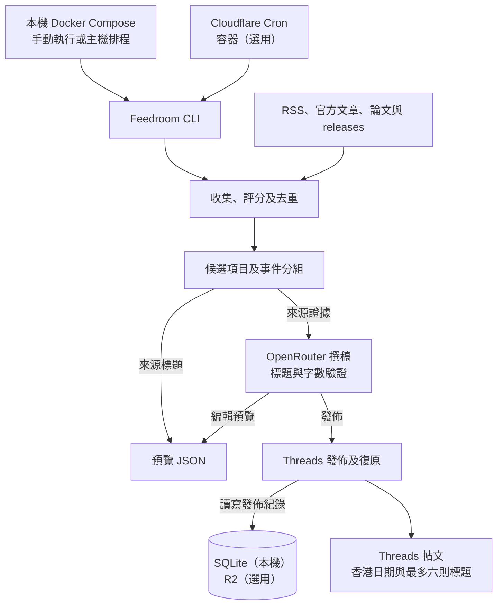

# Feedroom

Feedroom 每天為指定 Threads 帳戶整理一篇 AI 與資料科學摘要。第一行是香港日期（`YYYY-MM-DD`），接着用香港粵語逐行列出五至六則短標題，每篇最多六項。來源證據不足或受 500 字元上限所限時，可以少於五項。 [Threads 發佈規格](https://developers.facebook.com/documentation/threads/posts)

```text
2026-11-19
• 標題一
• 標題二
• 標題三
• 標題四
• 標題五
```

首則標題的原文網址用作 Threads 連結附件。預覽 JSON 的 `draft.source_urls` 和發佈紀錄會依標題順序保存每項對應的原文網址。 [Threads 連結附件](https://developers.facebook.com/documentation/threads/posts#links)

## 架構



## 本機 Docker

在運行每日摘要的電腦安裝 Docker 和 Compose v2。在 repo 根目錄建立本機 `.env`、建置映像，並先看一次來源預覽。Git 會忽略 `.env`。 [.env.example](.env.example)

```sh
cp -n .env.example .env
docker compose build feedroom
docker compose run --rm feedroom preview
```

`preview` 預設直接採用來源標題，可在未設定憑證時執行。要預覽正式的粵語摘要，在 `.env` 填入 `OPENROUTER_API_KEY` 和支援結構化輸出的 `OPENROUTER_MODEL`，再執行編輯預覽。兩種預覽都以收集日期作為香港日期，並將可用草稿輸出為 JSON。 [OpenRouter 結構化輸出](https://openrouter.ai/docs/guides/features/structured-outputs)

```sh
docker compose run --rm feedroom preview --editorial
```

### Threads 帳戶與試帖

在 Meta 建立 Threads App，用已加入的 tester 帳戶作首次驗證。將該帳戶的數字使用者 ID 填入 `THREADS_ACCOUNT_ID`，並將同一帳戶的長效 Threads User Access Token 填入 `THREADS_ACCESS_TOKEN`。Token 需具備 `threads_basic` 和 `threads_content_publish`。由操作者在到期前用 Meta 的 `refresh_access_token` 更新憑證。 [Meta 開始使用](https://developers.facebook.com/documentation/threads/get-started) · [發佈權限](https://developers.facebook.com/documentation/threads/posts#permissions)

確認編輯預覽和目標帳戶後，執行以下指令發佈試帖。成功時 CLI 會回傳 `published` 和 `post_id`。

```sh
docker compose run --rm feedroom publish
```

發佈會先核對 token 帳戶，並以執行當日的香港日期撰稿。草稿通過驗證後，程式建立帶 AI 標籤的 Threads container，待它就緒才發佈。當日已有帖文會回傳 `already_published`，無合適消息則跳過。若發佈回應中斷，重跑會先查原 container 和帳戶帖文。狀態仍不明時會暫停新發佈。 [Meta 發佈流程](https://developers.facebook.com/documentation/threads/posts) · [Meta 發佈狀態](https://developers.facebook.com/documentation/threads/troubleshooting)

### 每日排程與發佈紀錄

試帖確認後，由本機主機排程每日呼叫 Compose，並保留輸出及錯誤紀錄。排程時主機需開機，Docker 服務需已啟動。以下是 UTC 主機在香港時間 08:00 執行的 cron 範例。使用其他主機時區請換算時間，並換入實際 checkout 和 Docker 路徑。

```cron
0 0 * * * cd "/absolute/path/to/feedroom" && "/absolute/path/to/docker" compose --env-file .env run --rm feedroom publish
```

Compose 用 `threads-state` volume 保存 `/data/threads.sqlite3`。每日發佈會沿用各標題和合併來源的去重 ID。搬遷主機前先備份 volume，切換排程前先處理未確認的發佈，並確認新環境讀到同一份歷史。每個帳戶只啟用一個每日發佈排程，切換前先停用原有 Codex heartbeat 或其他舊觸發器。

## 來源與選題

`feedroom collect` 收集、正規化、評分和去重，並輸出 JSON。`latest` 收錄最近 36 小時的新聞、文章和 releases。`reading` 從 Hugging Face Daily Papers 回看 90 日，收錄至少 100 個 upvote 的論文，並連到原文摘要。收集時排除參考時間之後發佈的內容。 [Hugging Face Daily Papers API](https://huggingface.co/docs/huggingface_hub/main/en/package_reference/hf_api#huggingface_hub.HfApi.list_daily_papers)

撰稿前會合併同一事件的報道，並嘗試補讀已配置來源的文章正文。補讀遵守 `robots.txt`，遇到封鎖或正文太短時沿用來源摘要。OpenRouter 根據每組事件的證據撰寫短標題，程式核對事件 ID、數字、格式和字數。收集失敗的來源會記錄在 `collection_errors`，其餘來源繼續收集。

### 主要研究與工程來源

- OpenAI 官方綜合 feed 提供 Research 和 Signals 文章。 [OpenAI RSS](https://openai.com/news/rss.xml)
- Anthropic 文章從官方頁面讀取摘要和日期。 [Anthropic News](https://www.anthropic.com/news) · [Anthropic Research](https://www.anthropic.com/research)
- Google 和 Google DeepMind 的官方 blog 提供模型、研究、科學和應用文章。 [DeepMind Blog](https://deepmind.google/blog/rss.xml) · [Google Research](https://research.google/blog/rss/) · [Google Innovation & AI](https://blog.google/innovation-and-ai/rss/)
- Apple、Meta 和 Microsoft 補充機器學習研究與工程實務。 [Apple Machine Learning Research](https://machinelearning.apple.com/) · [Meta Engineering AI Research](https://engineering.fb.com/category/ai-research/feed/) · [Microsoft Research](https://www.microsoft.com/en-us/research/feed/)
- Netflix、Spotify 和 Uber 補充推薦系統、資料平台和 AI 工程。Uber 讀取官方工程頁當頁最多 20 篇。 [Netflix TechBlog](https://netflixtechblog.com/feed) · [Spotify Engineering](https://engineering.atspotify.com/feed/) · [Uber Engineering](https://www.uber.com/us/en/blog/engineering/)

另有 Hugging Face RSS、AWS Machine Learning Blog、Databricks、PyTorch、NVIDIA Blog、TLDR AI、MIT Technology Review AI、The Verge AI、TechCrunch AI、Hacker News Algolia 與指定 GitHub releases。TLDR AI 會展開至原文連結。企業工程文章須符合 AI、資料科學、資料工程、推薦系統或實驗等主題。覆蓋範圍取決於各來源提供的內容。

## Python 開發與重播

套件支援 Python 3.11 或以上。本機 Python CLI 讀取目前程序的環境變數。要用已收集的候選重現預覽，可先保存 `collect` 的 JSON，再傳給 `preview --candidates`。為收集或即時預覽指定 `--as-of` 可調整參考時間，歷史涵蓋範圍取決於來源網站。

```sh
python3 -m venv .venv
. .venv/bin/activate
python -m pip install '.[r2]'
feedroom collect > /tmp/feedroom-candidates.json
feedroom preview --candidates /tmp/feedroom-candidates.json
python -m unittest discover -s tests -v
node --test tests/cloudflare.test.mjs
```

原有 `python3 scripts/ai_news_collect.py` 仍可用於手動收集。其 `--mark-seen` 管理獨立的 14 日已讀紀錄。

## Cloudflare（選用）

`cloudflare.config.ts` 透過 Cloudflare Containers 和 Cron Triggers 在每日 08:00 HKT 執行同一映像。部署需 Cloudflare Workers Paid、Docker 和 Node.js 24.22 或同系列更新版本。用 `npm ci` 安裝指定的 CLI，再執行 `npx cf build` 檢查建置。`npx cf deploy` 的排程預設執行 `preview`。 [Cloudflare CLI](https://developers.cloudflare.com/cf/projects/) · [Cloudflare 排程容器](https://developers.cloudflare.com/containers/examples/cron/)

要在 Cloudflare 發佈，準備私人 R2 bucket，以及只限該 bucket 的 Object Read & Write 憑證。在 Worker Settings → Variables and Secrets 設定兩項 OpenRouter 變數、兩項 Threads 變數及 `FEEDROOM_R2_ACCOUNT_ID`、`FEEDROOM_R2_BUCKET`、`FEEDROOM_R2_ACCESS_KEY_ID`、`FEEDROOM_R2_SECRET_ACCESS_KEY`，再執行 `npx cf deploy --mode publish`。發佈歷史會保存於 `threads/<Threads account ID>.json`，跨容器休眠保留。 [Worker secrets](https://developers.cloudflare.com/workers/configuration/secrets/) · [R2 憑證](https://developers.cloudflare.com/r2/api/tokens/) · [Cloudflare 部署模式](https://developers.cloudflare.com/cf/projects/)

計劃日後切換 Cloudflare 時，可在本機首次正式發佈前把四項 R2 變數填入 `.env`，讓兩個環境沿用同一份紀錄。若本機已有 SQLite 歷史，先備份及遷移，再啟用新排程。

## 維護文件

- [專案指引](AGENTS.md)
- [架構與發佈流程](ARCHITECTURE.md)
- [變更紀錄](CHANGELOG.md)
